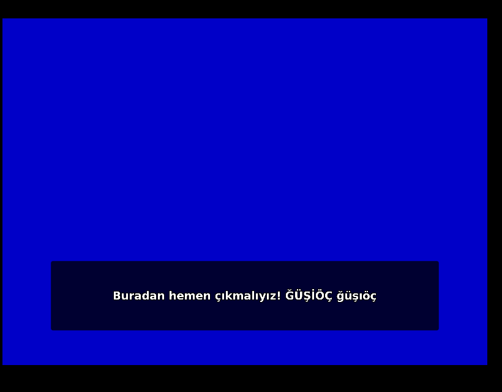

# GameSubTR — Oyun Altyazı Çevirici (EN → TR)

Oyun oynarken İngilizce altyazıları **gerçek zamanlı Türkçeye çevirir**. Her oyunda çalışır; altyazısı olmayan oyunlarda **oyunun sesini** yazıya döküp çevirir. Tam ekranda (exclusive fullscreen dahil) çalışır.



## Nasıl çalışır

| Kaynak | Yöntem |
|---|---|
| **Ekran altyazısı (OCR)** | Seçtiğin altyazı bölgesi DXGI Desktop Duplication (veya oyun içi hook) ile yakalanır → renk ayrıştırma + Otsu eşikleme → Windows OCR → kararlılık filtresi (harf harf beliren altyazıyı yarım çevirmez) |
| **Oyun sesi (Whisper)** | WASAPI *process loopback* ile **sadece oyunun sesi** → 16 kHz → Silero VAD (konuşma tespiti) → Whisper large-v3-turbo (GPU / Vulkan, yerel) |
| **Çeviri** | Claude → OpenAI uyumlu LLM (Ollama ile offline) → DeepL → Google (anahtarsız). Hata veren motor otomatik atlanır. Önceki replikler bağlam olarak gönderilir, karakter isimleri sözlükle korunur, çeviriler oyun bazında önbelleğe alınır. |
| **Gösterim** | *Pencere*: şeffaf, tıklamayı geçiren, ekran yakalamaya girmeyen üst katman (kenarlıksız + modern tam ekran). *Hook*: gerçek exclusive fullscreen oyunlarda altyazı DX9/DX11 ile **oyunun kendi ekranına** çizilir. *Auto* modu doğru olanı kendisi seçer. |

## Kurulum

1. **.NET 8 SDK** (yoksa): `winget install Microsoft.DotNet.SDK.8`
2. **İngilizce OCR paketi** (Türkçe Windows'ta genelde yüklü değildir) — PowerShell'i *yönetici olarak* aç:
   ```powershell
   Add-WindowsCapability -Online -Name "Language.OCR~~~en-US~0.0.1.0"
   ```
3. Derle:
   ```powershell
   .\build.ps1
   ```
   Çıktı: `dist\GameSubTR\GameSubTR.exe` (ve `dist\GameSubTR-win-x64.zip`).
   Hook DLL'leri `native\bin` içinde hazır gelir; MSVC ile yeniden derlemek istersen `.\build.ps1 -Native`.
   GitHub'a push edersen Actions aynı paketi otomatik üretir (`.github/workflows/build.yml`).

## Kullanım

1. `GameSubTR.exe`'yi çalıştır (sistem tepsisinde mavi **TR** simgesi çıkar).
2. Oyunu aç, ilk altyazı ekrana gelince **Ctrl+Shift+R** → altyazının çıktığı alanı fareyle çiz (2–3 satırlık pay bırak). Oyun bazında kaydedilir.
3. Bitti. Çeviri orijinal altyazının üstünde görünür.

| Kısayol | İşlev |
|---|---|
| `Ctrl+Shift+T` | Çeviriyi aç / kapat |
| `Ctrl+Shift+R` | Altyazı bölgesini seç |
| `Ctrl+Shift+M` | Kaynak modu: OCR → Ses → İkisi |
| `Ctrl+Shift+O` | Orijinal İngilizce metni de göster / gizle |

Kısayollar **Ayarlar → Kısayollar**'dan değiştirilebilir.

### Altyazısı olmayan oyunlar
`Ctrl+Shift+M` ile **Oyun sesi** moduna geç. İlk kullanımda Whisper modeli (~550 MB) indirilir. RTX 3060'ta yaklaşık 1–2 sn gecikmeyle çalışır. *İkisi* modunda ekranda altyazı varsa o kullanılır, yoksa ses.

### En iyi çeviri kalitesi
**Ayarlar → Çeviri**'ye Claude API anahtarını gir (console.anthropic.com). Konuşma bağlamını ve isimleri korur; altyazı metni kısa olduğu için maliyet çok düşüktür. *Çeviriyi dene* butonuyla test edebilirsin. Anahtar girmezsen ücretsiz Google kullanılır.

**Sözlük** (Ayarlar → Oyunlar): çevrilmemesi gereken isimleri her satıra bir tane yaz (`Geralt`), sabit çeviri için `Wild Hunt = Yabani Av`.

## Oyun ayarları (Ayarlar → Oyunlar)

- **Kaynak**: Ocr / Audio / Both
- **Gösterim**: Auto (önerilen) / Window / Hook
  - Hook yalnızca **tek oyunculu, anti-cheat'siz** oyunlarda kullanılmalı. DX12/Vulkan oyunlarda gerçek exclusive fullscreen yoktur; pencere modu zaten görünür.
- **Konum**: OverOriginal (orijinalin üstünü kapatır) / Fixed (sabit alt konum)
- **Altyazı rengi filtresi**: Auto genelde yeterli; sarı altyazılı oyunlarda *Yellow*, beyazda *White* daha temiz okur.
- Yazı boyutu, renk, arka plan opaklığı, OCR aralığı

## Sorun giderme

| Belirti | Çözüm |
|---|---|
| "İngilizce OCR paketi yüklü değil" | Kurulum 2. adımdaki komut |
| Çeviri görünmüyor (tam ekran) | Ayarlar → Oyunlar → Gösterim: **Hook**. Olmazsa oyunda *Borderless/Kenarlıksız* seç. |
| Hook yüklenemedi | Oyun yönetici olarak çalışıyorsa GameSubTR'yi de yönetici olarak aç |
| OCR yanlış okuyor | Bölgeyi sadece altyazıyı kapsayacak şekilde daralt; renk filtresini değiştir |
| Ses modunda müzik konuşma sanılıyor | Ayarlar → Ses → konuşma eşiğini 0.6'ya çıkar |
| Ses yakalanamadı | Windows 10 21H2+ / Windows 11 gerekir; ya da "sadece oyunun sesi" seçeneğini kapat |

Loglar: tepsi menüsü → *Log klasörünü aç* (`%LocalAppData%\GameSubTR\logs`). Ayarlar: `%LocalAppData%\GameSubTR\settings.json`.

## Proje yapısı

```
src/GameSubTR.Core     Platformdan bağımsız mantık (görüntü işleme, kararlılık, ses DSP, VAD segmentleme, çeviri zinciri, önbellek) — paket bağımlılığı yok
src/GameSubTR.App      WPF tepsi uygulaması: yakalama, Windows OCR, WASAPI, Silero, Whisper, overlay, hook oturumu
native/hook            C++ hook DLL (MinHook + Dear ImGui, DX9 + DX11, arka tampondan bölge okuma)
native/injector        DLL yükleyici (x86 / x64)
tests/                 xUnit testleri
```

## Doğrulananlar

- Core: 25 birim testi (görüntü ön işleme, Otsu, algısal özet, kararlılık/typewriter, yeniden örnekleme, VAD segmentleme, Whisper halüsinasyon filtresi, motor zinciri + yedekleme + önbellek, sözlük koruma).
- Hook DLL: mingw ile x86/x64 derlendi; wine + Xvfb altında gerçek DX9 ve DX11 test uygulamasına enjekte edildi → altyazı çizimi (Türkçe karakterler dahil) ve arka tampondan bölge okuma çalıştı (ekran görüntüsü yukarıda).
- WPF uygulaması Windows SDK gerektirdiği için Linux geliştirme ortamında derlenemedi; Windows'ta `build.ps1` veya GitHub Actions ile derlenir. İlk derlemede hata çıkarsa çıktıyı paylaşman yeterli.
